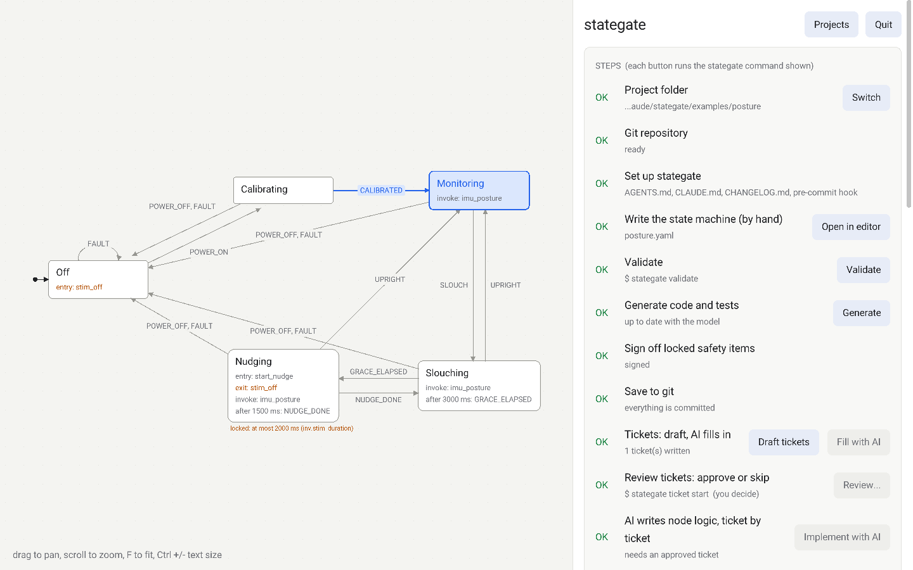

# stategate

Model-first development for code written by AI agents. You design the software
as a state machine in YAML. stategate generates the wiring and the transition
tests, any agent you like writes the logic inside each node, and a
deterministic gate decides what lands. The gate reports status; agents don't.

Status: weekend MVP. The command-line tool, the gate, the MCP server and an
app that runs each step work end to end on the posture wearable example.



## Build

Needs a C11 compiler, CMake, libyaml (`libyaml-dev` on Debian/Ubuntu,
`brew install libyaml` on macOS) and, for the generated code, Rust. The viewer
fetches raylib 5.5 at configure time; on Linux it also needs the X11 and GL
headers (`libxrandr-dev libxinerama-dev libxcursor-dev libxi-dev libgl-dev`).
Pass `-DSTATEGATE_VIEWER=OFF` to build only the command-line tool.

```sh
cmake -S . -B build && cmake --build build
sudo cmake --install build      # installs stategate (alias fsm) and stategate-view
scripts/redpaths.sh             # proves the gate turns red for each broken rule
scripts/mcp_smoke.py            # drives the MCP server through the whole AI loop
```

## Ten-minute walkthrough

```sh
cd examples/posture
stategate validate               # checks 1-3 on posture.yaml
stategate gen                    # Rust wiring, 48 generated tests, manifest
stategate gate                   # all 11 checks; writes .fsm/gate.json
cargo run --example sim -- 15000 POWER_ON CALIBRATED
```

The simulation runs Step 0 on fake hardware:

```
    0.0s  posture.Off --POWER_ON--> posture.Calibrating
    0.0s  posture.Calibrating --CALIBRATED--> posture.Monitoring
   10.0s  posture.Monitoring --SLOUCH--> posture.Slouching
   13.0s  posture.Slouching --GRACE_ELAPSED--> posture.Nudging
   13.0s  NUDGE
   14.5s  posture.Nudging --NUDGE_DONE--> posture.Slouching
```

## A new project, end to end

Every step is a command, so a future app or an MCP server can drive the same
flow. `you` steps happen at your terminal; `AI` steps work with any assistant.

```sh
# you: set up and design
mkdir blinky && cd blinky && git init
#   write blinky.yaml (see examples/posture/posture.yaml)
stategate init                 # AGENTS.md, CLAUDE.md, CHANGELOG.md, pre-commit hook
stategate validate             # checks 1-3
stategate-view .               # live view while you edit
stategate gen                  # Rust wiring, transition tests, node stubs
stategate signoff              # only when the model has locked items
git add -A && git commit -m "model"

# no AI: ticket skeletons
stategate ticket gen           # one draft per stub node: node, step and files filled in

# AI: fill in each draft (the ticket-writer role in AGENTS.md)
#   with MCP the AI calls list_drafts and fill_ticket itself
stategate ticket prompt --drafts   # every draft with its node and code, for any AI
stategate ticket fill T001 --title "..." --goal "..."    # draft becomes open
stategate ticket check
git add -A && git commit -m "tickets"

# you: approve or skip each one
stategate ticket start         # approved tickets queue; the first one starts

# AI: implement the active ticket, until green (the implementer role)
#   with MCP (see below) the AI calls get_task, write_file and run_gate itself
stategate ticket prompt        # goal, node, allowed files, current code, last errors
#   ...the AI edits the allowed files...
stategate ticket run           # green: commit, done, next ticket starts
                               # red: errors saved to the ticket; prompt again
# you, after 3 reds: stategate ticket split T001 "..." "..."
```

## Use it from your AI (MCP)

`stategate mcp` serves the AI steps as MCP tools over stdin/stdout, so any
MCP client can run the loop without copy and paste. Point it at the project:

```sh
# Claude Code
claude mcp add stategate -- stategate -C ~/dev/cot mcp
# or, in the project folder: stategate ai connect
```

```json
// Cursor, Claude Desktop and other clients: their MCP servers config
{ "mcpServers": { "stategate": { "command": "stategate", "args": ["-C", "/home/you/dev/cot", "mcp"] } } }
```

`stategate mcp config` prints that entry for the current folder, with the
full path of the binary. `stategate ai fill` and `stategate ai work` run
Claude Code headless on it with no other tools:

```sh
claude -p "<instruction>" --mcp-config "$(stategate mcp config)" --strict-mcp-config \
  --tools "" --allowedTools mcp__stategate --permission-mode dontAsk
```

| Tool | Role | Same as |
| --- | --- | --- |
| `status` | both | `stategate ticket list` |
| `list_drafts` | ticket writer | drafts with their node, step and files |
| `fill_ticket` | ticket writer | `stategate ticket fill <id> --title --goal` |
| `get_task` | implementer | `stategate ticket prompt` |
| `read_file` | both | read a project file |
| `write_file` | implementer | write a file the active ticket allows (others are refused) |
| `run_gate` | implementer | `stategate ticket run` |

Each tool runs the same CLI command in a child process with no terminal.
Sign-off, approving tickets and splits are not tools: they stay with you at
your terminal (`stategate signoff`, `stategate ticket start`,
`stategate ticket split`). Then ask your AI, for example: "Fill in the
stategate drafts", and after you approve, "Work the active stategate ticket
until the gate is green".

## The app

```sh
stategate-view              # opens on the projects screen
stategate-view ~/dev/cot    # opens that project
```

It opens maximized, title bar and all; F11 switches to full screen and back,
and `--windowed` starts in a normal window. Text, spacing and nodes grow with
the window, and Ctrl + / Ctrl - / Ctrl 0 make text larger, smaller or default
(saved in `~/.config/stategate/text_size`). The projects screen browses folders, opens one, creates a new folder
under the one you are in, and lists recent projects.

A project shows the machine on the left and the steps on the right. The
layout saved in the model places each state in a row and a column (states a
little apart share one); the app then sizes the grid so nodes never overlap
and keep room for edge labels at any text size.

The Steps box shows one step at a time, the one to work on next, and moves on
by itself when that step is done (the app reads `stategate status --json`).
The arrows at its top corners go back to an earlier step or look ahead; the
dots under the step number show which steps are done. A folder without git or
without stategate's files shows an **Initialize** button, both in the Steps
box and on the canvas. Each step's button runs the command shown under it and
prints its output, so everything the app does you can also do at a terminal:

| Step | Button runs |
|---|---|
| Initialize | `git init` when there is no `.git`, then `stategate init` |
| Write the state machine | opens the model in your default editor (`xdg-open`, `open` on macOS) |
| Validate | `stategate validate` |
| Generate | `stategate gen` |
| Sign off | `stategate signoff`, in a dialog where you confirm |
| Save to git | `git add -A && git commit` |
| Draft tickets | `stategate ticket gen` |
| Fill with AI | `stategate ai fill` (Claude Code over MCP), or `stategate ticket prompt --drafts \| <your command>` |
| Start review | `stategate ticket start`, answered in the ticket box: approve, skip or stop per ticket |
| Implement with AI | `stategate ai work` (Claude Code over MCP), or `stategate ticket prompt \| <your command>`, again for each next ticket |
| Run gate | `stategate ticket run` while a ticket is active, else `stategate gate` |

Filling in drafts and writing node logic are your AI's steps. **Your AI**
picks how the two AI buttons reach it (saved in `~/.config/stategate/ai_mode`):

- **Claude Code (MCP)**, the default when `claude` is on PATH. The buttons run
  `stategate ai fill` and `stategate ai work`: Claude Code headless with the
  stategate MCP server and nothing else (no shell, no file tools), so it can
  only fill tickets, write the active ticket's files and run the gate.
  **Connect** runs `stategate ai connect` (`claude mcp add -s local stategate
  ...` for this folder) so your own Claude Code chat here has the same tools,
  **Check** runs `stategate ai check` (`claude mcp get stategate`), and **Copy
  MCP config** copies `stategate mcp config` for any other MCP client.
- **Your command**: the buttons pipe the text prompt into a command you set
  (saved in `~/.config/stategate/ai_command`), run in the project folder. The
  prompt tells the AI to run `stategate ticket fill` for each draft and
  `stategate ticket run` when a ticket's code is done.
- **Copy the prompt**: the buttons copy it for you to paste into any AI.

Implement with AI goes on to the next ticket each time one turns green, and
stops when a ticket stays red, locks, or the queue is empty.
Approving tickets and signing off stay with you: they need a terminal, which
the AI's commands don't have. The confirmations run the real command on a
pseudo-terminal, so they are the same typed confirmations as at a terminal.
The app reloads the model and the gate result when either file changes.

Once `stategate ticket gen` has drafted tickets, a ticket box sits under
the steps. It shows one ticket at a time (the arrows step through them, the
dots are their statuses) in titled sections: the title and goal your AI
writes, and the nodes, files and step that `ticket gen` took from the model.
It reads `stategate ticket list --json` again whenever a ticket file changes,
so each ticket fills in as your AI runs `ticket fill`, and the box moves to
the ticket that changed. Review runs `stategate ticket start` on a
pseudo-terminal, as at a terminal, and its question is answered with the
Approve, Skip and Stop reviewing buttons in the box. `stategate ticket show
<id>` prints the same sections at a terminal.

Below that: the output of the last command, the last gate result from
`.fsm/gate.json`, a simulator and the step ladder. Click an event to fire it:
the active state lights up and the transition it took turns blue; ignored
events say so. Drag to pan, scroll to zoom, F to fit. The panel scrolls with the wheel,
its scrollbar, Page Up/Down and Home/End. Working through the Steps box
leaves the panel where it is (the output lands just below it); there is no
Quit button, close the window to exit. The machine itself stays
YAML you write by hand.

`--send EV1,EV2` fires events at start-up and `--screenshot out.png` saves one
frame and exits, which CI uses as a smoke test.

## How work flows

1. **You design the model** (`posture.yaml`). Every (state, event) pair is
   either handled under `on` or listed under `ignore`; a missing pair is an
   error. Safety rules are `locked` invariants.
2. **You sign off locked items** with `stategate signoff`. Changing one later
   turns the gate red until you sign off again. A model with nothing locked
   needs no sign-off.
3. **stategate generates** `src/gen/`, `tests/transitions.rs`,
   `tests/invariants.rs` and the manifest. It scaffolds one file per action
   and service once, tagged with node IDs, and never overwrites them.
4. **`stategate ticket gen` drafts the tickets**, with no AI: one per stub
   action or service in the active step, with the node, step and files
   (the node's file and `tests/logic_<node>.rs`) filled in.
5. **A ticket-writer AI fills them in** with `stategate ticket fill <id>
   --title ... --goal ...`, which turns a draft into an open ticket. It can't
   change the node, step or files. `stategate ticket new` writes a ticket
   from scratch, checked against the model the same way.
6. **You approve them** with `stategate ticket start`. It walks through every
   open ticket, showing it section by section (as `stategate ticket show
   <id>` does), and you type `approve` or
   `skip` for each at a terminal. Approved tickets queue in id order and the
   first one starts. `stategate ticket start T002` approves and starts one.
7. **An implementer AI works the active ticket.** `stategate ticket prompt`
   prints everything it needs as one block of Markdown: the goal, where the
   node runs, the allowed files and their code, and the last errors.
   `stategate ticket run` runs the gate: green commits the work, marks the
   ticket done and starts the next one; red saves the errors into the ticket
   for the next prompt. Three reds lock the ticket until you approve a split
   with `stategate ticket split`. Hand-setting a ticket to `active`, or
   changing one after you approved it, turns the gate red or keeps it from
   starting.
8. **The gate decides.** `ticket run` and the pre-commit hook both run all
   11 checks; `stategate gate` runs them without committing anything.

## The gate

Checks run in order and stop at the first failure.

| # | Check | Fails when |
| --- | --- | --- |
| 1 | schema | the YAML has unknown keys, wrong types or missing fields |
| 2 | statechart | no single initial state, an unreachable state, a dangling target, or a pair neither handled nor ignored |
| 3 | invariants | a locked invariant doesn't hold on the model (e.g. a state ignores FAULT) |
| 4 | signoff | locked items differ from what the architect signed (nothing locked: passes) |
| 5 | drift | a generated file was edited by hand, or the model changed without `gen` |
| 6 | no_wildcards | generated code contains a `_ =>` match arm |
| 7 | trace_tags | an action or service file lacks its `@action`/`@service`/`@node` tags |
| 8 | stubs | a locked item is a stub; with `--release`, any stub remains |
| 9 | ticket_scope | a file outside the active ticket changed, the ticket wasn't approved or changed after approval, or it is locked |
| 10 | changelog | `CHANGELOG.md` has no `## <ticket>` entry naming the ticket's node IDs |
| 11 | tests | `cargo test` fails |

## Invariants the gate can verify

| Kind | Example | Enforced by |
| --- | --- | --- |
| `every_state_handles` | any FAULT goes to Off | check 3 on the model, plus a generated test per state |
| `max_time_in_state` | Nudging lasts at most 2000 ms | a generated watchdog in `Machine::tick`, plus a generated test |
| `hal_clamp` | intensity is at most 3 | the generated `SafeHal`, the only HAL handle node logic receives, plus a generated test |

## Known limits

- Sign-off, ticket approval and ticket splits ask for typed confirmation at a
  terminal. That stops an agent from approving by accident, not one that sets
  out to fake a terminal or to compute the approval hash itself. Real
  protection (signed commits, a key only you hold) comes later.
- Ticket files are exempt from the scope check, because they change as the
  queue moves; their approval hashes guard them instead. That means an agent
  could edit the active ticket's failure counter. Moving the counter out of
  reach comes later.
- Flat states only; no nesting, parallel regions or history yet.
- The app's simulator follows the model's transition table in C, separately
  from the generated Rust. Both read the same table, and the generated tests
  cover the Rust side.
- Rust is the only target language so far; C is next.
