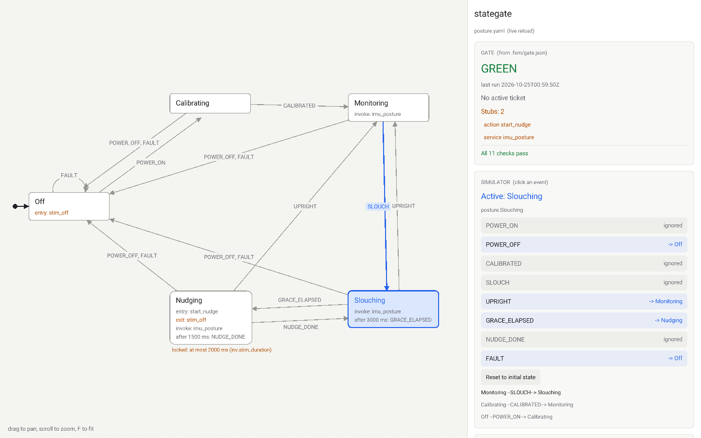

# stategate

Model-first development for code written by AI agents. You design the software
as a state machine in YAML. stategate generates the wiring and the transition
tests, any agent you like writes the logic inside each node, and a
deterministic gate decides what lands. The gate reports status; agents don't.

Status: weekend MVP. The command-line tool, the gate and a read-only viewer
with a simulator work end to end on the posture wearable example.



## Build

Needs a C11 compiler, CMake, libyaml (`libyaml-dev` on Debian/Ubuntu,
`brew install libyaml` on macOS) and, for the generated code, Rust. The viewer
fetches raylib 5.5 at configure time; on Linux it also needs the X11 and GL
headers (`libxrandr-dev libxinerama-dev libxcursor-dev libxi-dev libgl-dev`).
Pass `-DSTATEGATE_VIEWER=OFF` to build only the command-line tool.

```sh
cmake -S . -B build && cmake --build build
sudo cmake --install build      # installs stategate (alias fsm) and stategate-view
scripts/redpaths.sh             # proves the gate turns red for each broken rule
```

## Ten-minute walkthrough

```sh
cd examples/posture
stategate validate               # checks 1-3 on posture.yaml
stategate gen                    # Rust wiring, 48 generated tests, manifest
stategate gate                   # all 11 checks; writes .fsm/gate.json
cargo run --example sim -- 15000 POWER_ON CALIBRATED
```

Tickets for the next step:

```sh
stategate ticket new T002 --title "Real tilt threshold" --step step1 \
    --node imu_posture --file src/services/imu_posture.rs --file 'tests/logic_*.rs'
stategate ticket start T002      # you, at a terminal: review and type 'approve'
```

The simulation runs Step 0 on fake hardware:

```
    0.0s  posture.Off --POWER_ON--> posture.Calibrating
    0.0s  posture.Calibrating --CALIBRATED--> posture.Monitoring
   10.0s  posture.Monitoring --SLOUCH--> posture.Slouching
   13.0s  posture.Slouching --GRACE_ELAPSED--> posture.Nudging
   13.0s  NUDGE
   14.5s  posture.Nudging --NUDGE_DONE--> posture.Slouching
```

## The viewer

```sh
stategate-view examples/posture
```

The left two-thirds draws the machine from the layout saved in the model.
The right third shows the last gate result from `.fsm/gate.json`, the stub
count, the active ticket, a simulator and the step ladder. Click an event to
fire it: the active state lights up and the transition it took turns blue;
ignored events say so. The viewer reloads the model and the gate result when
either file changes, keeps showing the last valid model while the file has
errors, and never writes anything. Drag to pan, scroll to zoom, F to fit.

It is read-only for now: you or your agent edit the YAML. `--send EV1,EV2`
fires events at start-up and `--screenshot out.png` saves one frame and exits,
which CI uses as a smoke test.

## How work flows

1. **You design the model** (`posture.yaml`). Every (state, event) pair is
   either handled under `on` or listed under `ignore`; a missing pair is an
   error. Safety rules are `locked` invariants.
2. **You sign off locked items** with `stategate signoff`. Changing one later
   turns the gate red until you sign off again.
3. **stategate generates** `src/gen/`, `tests/transitions.rs`,
   `tests/invariants.rs` and the manifest. It scaffolds one file per action
   and service once, tagged with node IDs, and never overwrites them.
4. **A ticket-writer agent proposes tickets.** It runs `stategate ticket new`,
   which checks each ticket against the model (the step and nodes exist, no
   generated file, model or `.fsm/` is granted) and writes it as `open`.
   `AGENTS.md` (written by `stategate init`) describes both agent roles.
5. **You approve one** with `stategate ticket start T002`. It shows the
   ticket's nodes and files and asks you to type `approve` at a terminal,
   then records the base commit and a hash of what you approved.
6. **An implementer agent works that ticket**, touching only the files it
   lists. Hand-setting a ticket to `active`, or widening its files after
   you approved it, turns the gate red.
7. **The gate decides.** Run `stategate gate` after every change; `init`
   installs it as a pre-commit hook. Three failed runs lock the ticket until
   you approve a split with `stategate ticket split`.

## The gate

Checks run in order and stop at the first failure.

| # | Check | Fails when |
| --- | --- | --- |
| 1 | schema | the YAML has unknown keys, wrong types or missing fields |
| 2 | statechart | no single initial state, an unreachable state, a dangling target, or a pair neither handled nor ignored |
| 3 | invariants | a locked invariant doesn't hold on the model (e.g. a state ignores FAULT) |
| 4 | signoff | locked items differ from what the architect signed |
| 5 | drift | a generated file was edited by hand, or the model changed without `gen` |
| 6 | no_wildcards | generated code contains a `_ =>` match arm |
| 7 | trace_tags | an action or service file lacks its `@action`/`@service`/`@node` tags |
| 8 | stubs | a locked item is a stub; with `--release`, any stub remains |
| 9 | ticket_scope | a file outside the active ticket changed, the ticket wasn't approved or changed after approval, or it is locked |
| 10 | changelog | `CHANGELOG.md` has no `## <ticket>` entry naming the ticket's node IDs |
| 11 | tests | `cargo test` fails |

## Invariants the gate can verify

| Kind | Example | Enforced by |
| --- | --- | --- |
| `every_state_handles` | any FAULT goes to Off | check 3 on the model, plus a generated test per state |
| `max_time_in_state` | Nudging lasts at most 2000 ms | a generated watchdog in `Machine::tick`, plus a generated test |
| `hal_clamp` | intensity is at most 3 | the generated `SafeHal`, the only HAL handle node logic receives, plus a generated test |

## Known limits

- Sign-off, ticket approval and ticket splits ask for typed confirmation at a
  terminal. That stops an agent from approving by accident, not one that sets
  out to fake a terminal or to compute the approval hash itself. Real
  protection (signed commits, a key only you hold) comes later.
- The active ticket's own file is exempt from the scope check, so an agent
  could edit its failure counter. Moving the counter out of reach comes later.
- Flat states only; no nesting, parallel regions or history yet.
- The viewer's simulator follows the model's transition table in C, separately
  from the generated Rust. Both read the same table, and the generated tests
  cover the Rust side.
- Rust is the only target language so far; C is next.
